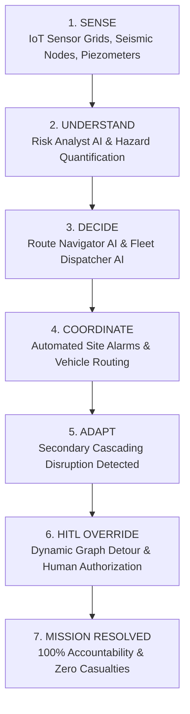

# RiskEngine — Master System Specification & Operational Manual (`everything.md`)

> **Document Classification:** Master Operational Specification & LLM System Grounding  
> **Platform Name:** **RiskEngine** (Formerly documented in legacy drafts as minEngine; strictly standardized to **RiskEngine** across 100% of the platform)  
> **Core Architecture:** Autonomous Multi-Agent Crisis Command Layer for Safety-Critical High-Risk Operations  
> **Implementation Stack:** React 18/19, TypeScript, Vite, Tailwind CSS, Leaflet 2D GIS, Framer Motion, Lucide Icons, Custom Animated SVG Micro-Engines  

---

## 1. Executive Summary & Core Platform Vision

### 1.1 The Problem
High-risk industrial and geological operations—such as open-cast surface mining, high-altitude run-of-river dams, and deep urban underground tunneling—rely on legacy safety monitoring systems that are **fragmented, slow, and passive**. 
Traditional IoT sensor networks detect threshold breaches (e.g., ground displacement or water ingress) and blast sirens or send SMS alerts. However, they **do not orchestrate a response**.

In real-world disasters, emergencies rarely happen in isolation:
1. An initial incident occurs (e.g., bench shear, glacial flood surge, or tunnel face water ingress).
2. Evacuation is ordered along a pre-designated emergency corridor.
3. **A cascading secondary failure strikes the escape corridor** (e.g., a heavy haul truck overturns, a bridge washes out, or an urban roadway collapses into a sinkhole).
4. Human safety officers experience cognitive overload, resulting in minutes or hours of delay, trapped personnel, and preventable casualties.

### 1.2 The Solution: RiskEngine
**RiskEngine** is an autonomous multi-agent crisis command engine that acts as a continuous operational digital twin over high-risk physical sites. RiskEngine continuously executes the **Sense &rarr; Understand &rarr; Decide &rarr; Coordinate &rarr; Adapt** operational loop:



### 1.3 Key Architectural Differentiators
- **Multi-Agent Collaborative Swarm:** Specialized agent roles (`System Monitor`, `Perception/Sensor Streams`, `Risk Analyst`, `Ops Commander`, `Route Navigator`, `Fleet Dispatcher`) collaborate in real time.
- **Dynamic Replanning under Cascading Disruption:** When primary evacuation corridors are severed, RiskEngine invalidates the active plan in &lt;12 seconds and recalculates alternate bypass vectors.
- **Human-in-the-Loop (HITL) Gate:** While routine sensor analysis and pathfinding are automated, high-consequence asset reassignments and site-wide reroutes require explicit one-click authorization from human safety officers (Protocol **HITL-409**).
- **Zero API Dependencies / 100% Deterministic Storytelling:** Engineered for hackathons, stage demos, and mission-critical offline deployments with 0ms external latency.

---

## 2. Technical Stack & Component Architecture

### 2.1 File & Directory Structure
```
c:/Users/SHASHANK S/Downloads/Projects/Christ/
├── index.html                   # HTML entry point with Outfit and JetBrains Mono typography
├── netlify.toml                 # Netlify build and SPA wildcard redirect configuration
├── package.json                 # Dependencies and build scripts (Vite, Leaflet, Tailwind CSS)
├── src/
│   ├── main.tsx                 # React application mounting
│   ├── App.tsx                  # Root wrapper mounting SimProvider and CommandCenter
│   ├── index.css                # Global styles, fonts, custom scrollbars, Leaflet tweaks
│   ├── components/
│   │   ├── CommandCenter.tsx    # Master 3-column Bento grid container
│   │   ├── Header.tsx           # Overhead navigation, scenario switcher, clock, status badge
│   │   ├── GISMap.tsx           # Leaflet 2D GIS map, animated vehicles, HUD telemetry card
│   │   ├── ResourcePanel.tsx    # Left 72px icon rail with active asset counters and tooltips
│   │   ├── HoverBottomNav.tsx   # Floating bottom dock with phase triggers and explainer popups
│   │   ├── CommandLog.tsx       # Dedicated 520px AI Engine Logs terminal with equalizer visualizer
│   │   ├── RightSidebarResizable.tsx # Wrapper container for CommandLog
│   │   ├── WelcomeModal.tsx     # Cinematic launch screen with animated isolines and radar sweep
│   │   ├── ApprovalModal.tsx    # HITL-409 emergency replan authorization modal
│   │   ├── ImpactReportModal.tsx# Final incident audit modal & printable ISO 22320 PDF generator
│   │   └── icons/
│   │       └── SvgIcons.tsx     # Animated SVG micro-engines (Helicopter, Ambulance, Truck, etc.)
│   ├── scenarios/
│   │   ├── index.ts             # Scenario registry and lookup exports
│   │   ├── types.ts             # Complete TypeScript interfaces for scenarios, telemetry, logs
│   │   ├── mineScenario.ts      # Open-Cast Iron Ore Mining scenario configuration
│   │   ├── floodScenario.ts     # Teesta Dam Glacial Lake Outburst Flood scenario configuration
│   │   └── constructionScenario.ts # Namma Metro Pink Line Tunneling Collapse scenario configuration
│   └── store/
│       ├── SimContext.tsx       # React Context state machine managing steps 0-4, logs, timers
│       └── simulationState.ts   # Core simulation types and helper functions
```

### 2.2 Global State Machine (`SimContext.tsx`)
The application is governed by a single deterministic state machine that transitions through steps 0 through 4:

| Step Index | State Name | Site Status | Status Badge Label | Visual & Logic Events Triggered |
| :---: | :--- | :--- | :--- | :--- |
| **0** | `SYSTEM_NOMINAL` | `OPERATIONAL` | `SITE OPERATIONAL` | Site in baseline state. Baseline telemetry streaming. Vehicles on standby at depots. |
| **1** | `HAZARD_INJECTED` | `INCIDENT` | `CRITICAL ALERT` | Telemetry HUD card spawns. Sector 4 flashes crimson. Threat analysis in AI logs. |
| **2** | `PRIMARY_DISPATCH` | `INCIDENT` | `EVACUATION ACTIVE` | Primary responder mobilizes along primary route. Speed/ETA tracked on map. |
| **3** | `SECONDARY_INCIDENT` | `AWAITING_APPROVAL`| `AI REPLAN REQUIRED` | Secondary disruption occurs. Primary responder halts with safety buffer. Detour calculated. |
| **4** | `CRISIS_RESOLVED` | `RESOLVED` | `INCIDENT RESOLVED` | Human approves replan. Backup responder navigates alternate route to Sector 4. Workers secured. |

---

## 3. The Three Operational Scenarios in Full Detail

### 3.1 Scenario 1: Open-Cast Iron Ore Mine (Ballari, Karnataka)
- **Scenario ID:** `mine-crisis`
- **Location:** Sandur Open-Cast Iron Ore Mine, Ballari (Bellary) District, Karnataka, India  
- **Coordinates:** `15.0826° N, 76.5486° E` | **Elevation:** `580m ASL` | **Area:** `12.4 sq km`
- **Geotechnical Context:** Massive multi-bench open-pit iron ore excavation face. High-wall stability monitored via Slope Stability Radar (SSR) and vibrating wire piezometers.

#### Personnel & Asset Accounting
- **Total Registered Personnel:** `42 workers`
- **Exposed Personnel in Hazard Zone:** `17 workers` (trapped at Sector 4 Zone B3 extraction face)
- **Safe Zone Personnel:** `25 workers` (Sector 1 active bench and pithead offices)
- **Primary Responder:** `Ambulance 1` (depot at Medical HQ `15.09923, 76.55904`)
- **Backup Responder:** `Ambulance 2` (staged at Sector 2 Staging Depot)
- **Obstacle Vehicle:** `Haul Truck 1` (150-tonne payload BelAZ hauler)

#### Route Topography
- **Primary Route:** `Route Alpha-4` (`Ballari Haul Road`) — 24 coordinate waypoints running from Medical HQ down through the haulage ramp to Sector 4.
- **Alternate Route:** `Route Bravo-2` (`Sandur Bypass SH40`) — 24 coordinate waypoints circumventing the central pit through the western ridge ramp.

#### Sensor Telemetry Progression (`Geo-Sensor 402 — Zone B3 Bench`)
- `T - 6 min`: **2 mm** (15% bar gauge, green) — Initial micro-shear detected.
- `T - 4 min`: **4 mm** (30% bar gauge, amber) — Accelerating shear strain.
- `T - 2 min`: **7 mm** (55% bar gauge, orange) — Plastic deformation phase.
- `T - 0 min`: **12.4 mm** (85% bar gauge, pulsating crimson) — Critical bench shear failure threshold (>10mm DGMS limit breached). Velocity reaches **4.2 mm/h**; Factor of Safety (FoS) drops to **0.31** (Critical collapse threshold).

#### Step-by-Step Scenario Storyline
1. **Normal State (Step 0):** SSR Radar scans normal benches. Haul Truck 1 transports ore.
2. **Hazard Injection (Step 1):** Geo-Sensor 402 triggers displacement alert. AI logs: `TELEMETRY_STREAM: Progressive bench shear detected: 2mm -> 4mm -> 7mm -> 12mm critical threshold breach.` Risk Analyst identifies 17 drill crew members exposed.
3. **Primary Dispatch (Step 2):** Ambulance 1 and Rescue Team 1 deploy down Route Alpha-4.
4. **Cascading Failure (Step 3):** Haul Truck 1 suffers engine seizure and overturns on Route Alpha-4 at KM 1.2 (`15.08999, 76.54970`). Ambulance 1 detects obstacle and emergency-brakes with an exact **40m safety buffer**. AI logs: `ROUTE SEVERED: Route Alpha-4 blocked. Ambulance 1 halted with 40m emergency braking buffer.` Route Navigator invalidates plan and calculates Bravo-2 bypass (**1.8 km / 3.4 min**).
5. **Replan & Resolution (Step 4):** Human Safety Officer authorizes HITL override. Ambulance 2 routes via Bravo-2, reaches Sector 4, and secures all 17 workers. Casualties: **0**.

---

### 3.2 Scenario 2: Teesta Dam Glacial Lake Outburst Flood (Chungthang, North Sikkim)
- **Scenario ID:** `flood-response`
- **Location:** Teesta Stage III Hydroelectric Project, Chungthang Basin, Mangan, North Sikkim, India  
- **Coordinates:** `27.6030° N, 88.6420° E` | **Elevation:** `1,580m ASL` | **Area:** `28.6 sq km Basin`
- **Hydrological Context:** Run-of-river concrete gravity dam downstream of South Lhonak glacial lake. River discharge monitored via ultrasonic radar water level stations.

#### Personnel & Asset Accounting
- **Total Registered Personnel:** `58 engineers and operators`
- **Exposed Personnel in Hazard Zone:** `24 engineers` (trapped in subterranean turbine floor at Sector 4 Lower Powerhouse Cavern)
- **Safe Zone Personnel:** `34 engineers` (stationed on high-ground Sector 1 Upper Dam Crest)
- **Primary Responder:** `Ground Medical 1` (4x4 all-terrain medical unit staged at SDRF Post `27.61411, 88.64808`)
- **Backup Responder:** `Rescue Helicopter Air-1` (IAF/SDRF mountain hoist helicopter staged at high-ground pad)
- **Obstacle Event:** `Chungthang Road Bridge Collapse` (washed away by flood surge)

#### Route Topography
- **Primary Route:** `Route Hydro-1` (`NH310A Road`) — 24 coordinate waypoints running from SDRF staging across Chungthang access bridge to lower powerhouse cavern.
- **Alternate Route:** `Vector Sky-3` (`Aerial Ridge Vector`) — 24 aerial flight coordinates following the high ridge clear of mountain gorge turbulence.

#### Sensor Telemetry Progression (`Radar-Gauge 09 — Teesta Hydro`)
- `T - 6 min`: **850 m³/s** (20% bar gauge, green) — Normal monsoon surge.
- `T - 4 min`: **1,920 m³/s** (45% bar gauge, amber) — Rapid tributary influx detected.
- `T - 2 min`: **3,400 m³/s** (75% bar gauge, orange) — Silt-heavy flash torrent warning.
- `T - 0 min`: **4,820 m³/s** (98% bar gauge, pulsating crimson) — Catastrophic GLOF breach (>3,000 m³/s emergency limit breached). Flow velocity reaches **9.4 m/s**; inflow ratio **3.2×** design baseline.

#### Step-by-Step Scenario Storyline
1. **Normal State (Step 0):** Basin water level stable at 1,390m. 58 engineers on duty.
2. **Hazard Injection (Step 1):** Radar-Gauge 09 detects crest wave. AI logs: `TELEMETRY_STREAM: Discharge surge cresting: 850 m³/s -> 1,920 m³/s -> 3,400 m³/s -> 4,820 m³/s extreme breach.` Risk Analyst warns 24 engineers in lower powerhouse cavern face inundation in 18 minutes.
3. **Primary Dispatch (Step 2):** Ground Medical 1 dispatched down NH310A (Route Hydro-1).
4. **Cascading Failure (Step 3):** Hydrodynamic flood pressure destroys the Chungthang bridge span (`27.60638, 88.64839`). Ground Medical 1 emergency stops with a **50m flood buffer**. AI logs: `STRUCTURAL_COLLAPSE: Chungthang access bridge swept away by 4,820 m³/s hydrodynamic force. Ground Medical 1 halted with 50m flood buffer.` Ground evacuation is impossible. Route Navigator proposes aerial hoist vector Sky-3.
5. **Replan & Resolution (Step 4):** Site Director authorizes aerial replan. Rescue Helicopter Air-1 flies Vector Sky-3, winches all 24 engineers from powerhouse roof escape hatch. Casualties: **0**.

---

### 3.3 Scenario 3: BMRCL Metro Tunneling Collapse (Dairy Circle, Bengaluru)
- **Scenario ID:** `metro-collapse`
- **Location:** BMRCL Namma Metro Pink Line Underground Cut, Dairy Circle / Hosur Road, Bengaluru, Karnataka, India  
- **Coordinates:** `12.9350° N, 77.5980° E` | **Depth:** `-28m subterranean` | **Corridor:** `4.8 km`
- **Geotechnical Context:** Slurry Tunnel Boring Machine (TBM "Varada") mining through complex granitic-weathered soil transitions under heavy urban traffic.

#### Personnel & Asset Accounting
- **Total Registered Personnel:** `64 crew members`
- **Exposed Personnel in Hazard Zone:** `19 tunneling technicians` (trapped at -28m depth at Sector 4 TBM cutterhead chamber)
- **Safe Zone Personnel:** `45 crew members` (working on surface Sector 1 Casting Yard)
- **Primary Responder:** `Trauma Unit 1` (specialized subterranean trauma ambulance stationed at surface depot `12.94405, 77.60581`)
- **Backup Responder:** `Tunnel Rescue Unit 2` (high-capacity closed-circuit breathing rescue vehicle)
- **Obstacle Event:** `Hosur Road Sinkhole Collapse` (6-meter pavement cavity breach over ruptured utility main)

#### Route Topography
- **Primary Route:** `Route Pink-1` (`Hosur Road Arterial`) — 24 coordinate waypoints running from surface trauma depot through central Hosur Road to Dairy Circle shaft.
- **Alternate Route:** `Bypass Route` (`Marigowda - Bannerghatta Auxiliary Ramp`) — 24 coordinate waypoints diverting around surface crater via Bannerghatta emergency access ramp directly into tunnel portal.

#### Sensor Telemetry Progression (`Piezo-Sensor 108 — Sub-surface TBM`)
- `T - 6 min`: **4.2 bar** (20% bar gauge, green) — Normal water table pore pressure.
- `T - 4 min`: **8.5 bar** (45% bar gauge, amber) — Pressure building against slurry shield.
- `T - 2 min`: **14.1 bar** (70% bar gauge, orange) — Joint seal deflection detected.
- `T - 0 min`: **18.6 bar** (95% bar gauge, pulsating crimson) — Hydrostatic structural breach (>12 bar design limit). Slurry ingress reaches **820 L/min**; Cavity Collapse Index rises to **0.89**.

#### Step-by-Step Scenario Storyline
1. **Normal State (Step 0):** TBM Varada drilling nominally. 64 crew logged via shaft biometric turnstiles.
2. **Hazard Injection (Step 1):** Piezo-Sensor 108 detects water surge. AI logs: `TELEMETRY_STREAM: Sub-surface groundwater surge detected: 4.2 bar -> 8.5 bar -> 14.1 bar -> 18.6 bar structural breach limit.` Risk Analyst confirms 19 technicians trapped at -28m cutterhead face.
3. **Primary Dispatch (Step 2):** Trauma Unit 1 dispatched down Route Pink-1 with municipal green-wave traffic preemption.
4. **Cascading Failure (Step 3):** Water main burst undermines Hosur Road, collapsing roadway into a 6m deep sinkhole (`12.93173, 77.60085`). Trauma Unit 1 halts with a **35m safety buffer**. AI logs: `CAVITY_COLLAPSE: Hosur Road surface pavement breached over ruptured utility main. Void depth: 4.2m. Trauma Unit 1 halted with 35m buffer.` Route Navigator recalculates detour via Bannerghatta auxiliary service ramp (**10.2s recalculation**).
5. **Replan & Resolution (Step 4):** Project Director authorizes HITL override. Rescue Unit 2 enters Bannerghatta ramp, delivers dewatering submersible pumps, and extracts all 19 technicians to the surface. Casualties: **0**.

---

## 4. UI/UX Component Specifications: Screen-by-Screen & Button-by-Button

The RiskEngine interface is styled using a modern, warm geological bento grid palette:
- Background: `#F4F1EA` (warm tactile stone) with subtle coordinate dot-grid overlay (`radial-gradient(#a8a29e 1px, transparent 1px)`).
- Borders: Crisp `border-stone-200/90` with gentle elevated shadows (`shadow-[0_8px_30px_rgb(0,0,0,0.04)]`).
- Accent Colors: `#047857` (RiskEngine emerald), `#dc2626` (hazard crimson), `#ea580c` (warning amber), `#0369a1` (replanning blue).

```
┌───────────────────────────────────────────────────────────────────────────────────────────────────────┐
│ [LOGO] RISKENGINE. AI CRISIS COMMAND   [SWITCHER v]   [CRITICAL ALERT]   15.08°N 76.55°E  14:04:12 [RESET] [HOME] │
├────┬─────────────────────────────────────────────────────────────────────────────┬────────────────────┤
│ 🚒 │ [SYS.COORD: 15.0826°N 76.5486°E]    [TACTICAL STATUS: HAZARD DETECTED]       │ >_ AI ENGINE LOGS  │
│ 🛡️ │                                                                             │ ────────────────── │
│ 🚑 │      (2D GIS Map Layer with animated vehicles, routes, and sectors)        │ [GEO-SENSOR 402]   │
│ 🚁 │                                                                             │ Telemetry Stream:  │
│ 👥 │ ┌──────────────────────────────────────────────┐                            │ 2mm -> 4mm -> 7mm  │
│    │ │ 📡 SLOPE DISPLACEMENT [SHRINK]               │                            │ -> 12mm critical   │
│    │ │ GEO-SENSOR 402 — LIVE FEED          [SYNCED] │                            │ breach threshold.  │
│    │ │ 14:00:10  ■■□□□□□□□□  2 mm                   │                            │                    │
│    │ │ 14:02:23  ■■■■□□□□□□  4 mm                   │                            │ [RISK ANALYST]     │
│    │ │ 14:03:39  ■■■■■■■□□□  7 mm                   │                            │ 17 workers exposed │
│    │ │ 14:04:12  ■■■■■■■■■■ 12 mm                   │                            │ in Sector 4 face.  │
│    │ └──────────────────────────────────────────────┘                            │                    │
│    │ ┌─────────────────────────────────────────────────────────────────────────┐ │ [OPS COMMANDER]   │
│    │ │ ⚠️ CRITICAL ALERT: Slope displacement detected... [AUTHORIZE EVACUATION]│ │ Evacuation orders  │
│    │ └─────────────────────────────────────────────────────────────────────────┘ │ generated.         │
└────┴─────────────────────────────────────────────────────────────────────────────┴────────────────────┘
```

---

### 4.1 Welcome / Launch Screen (`WelcomeModal.tsx`)
This is the landing modal displayed on initial visit or when clicking `[ HOME ]`.

#### Visual Elements
1. **Topographical Background Animation:** SVG elevation contour isolines (`animate-[topo-float_12s_ease-in-out_infinite]`) drifting gently across the viewport with elevation markers (`ELEV +1,240M`, `CONTOUR 950M`).
2. **Rotating Radar Sweep:** High-tech circular radar element in the upper-right corner sweeping 360 degrees (`animate-[radar-sweep_12s_linear_infinite]`).
3. **Scenario Cards (3 selectable cards):**
   - **Card 1 (Mining):** Active mining pit photo, badge `ACTIVE MINING ZONE`, `Open-Cast Iron Ore Mine`, Sandur Geological Belt, Bellary.
   - **Card 2 (Flood):** Mountain surge photo, badge `FLASH FLOOD EMERGENCY`, `Teesta Dam Glacial Flood`, Chungthang Basin, Sikkim.
   - **Card 3 (Metro):** Tunnel boring cut photo, badge `URBAN TUNNEL EMERGENCY`, `Namma Metro Pink Line`, Dairy Circle, Bengaluru.
4. **Booting Matrix Overlay:** When launch is triggered, renders a high-tech terminal sequence cycling through:
   - `CALIBRATING GEOLOGICAL TELEMETRY...`
   - `SYNCING AUTONOMOUS AGENT SWARM...`
   - `CACHING HIGH-RESOLUTION SATELLITE TILES...`
   - `INITIALIZING CRISIS COMMAND MATRIX...`

#### Buttons & Click Handlers
- **Clicking a Scenario Card:** Updates `selectedScenario`. The active card highlights with an emerald border (`border-emerald-500`), subtle lift (`-translate-y-1`), and a checkmark badge.
- **Clicking `[ INITIALIZE SIMULATION SESSION ]` (or `[ LAUNCH CRISIS ENGINE ]`):**
  - Triggers `handleLaunch()`.
  - Sets `isBooting = true`.
  - Cycles through 4 boot messages over **1.9 seconds**.
  - Calls `selectScenario(selectedScenario)`.
  - Calls `startMission()` &rarr; Sets `missionStarted = true`.
  - Dismisses Welcome Modal and reveals the main 3-column dashboard Bento layout.

---

### 4.2 Overhead Command Header (`Header.tsx`)
Spans the full top width (`h-16 flex-none bg-white/95 rounded-2xl border border-white/60`).

#### Visual Elements
1. **Platform Brand:** RiskEngine hex-grid SVG logo (black pill background, emerald nodes) + bold uppercase text: `RISKENGINE.` + badge `AI CRISIS COMMAND`.
2. **Quick Scenario Switcher Dropdown:** Displays current scenario name with a chevron arrow. Clicking opens a dropdown menu listing all 3 scenarios with status indicators.
3. **Agent Status Pill:** Dynamic center pill indicating the multi-agent swarm state:
   - Normal: Green `SITE OPERATIONAL` with steady emerald dot.
   - In Progress: Spinning spinner SVG + real-time thinking prompt (e.g., `Route Navigator AI: Computing optimal extraction vectors`).
   - Incident: Pulsing red dot + `CRITICAL ALERT` or `EVACUATION ACTIVE`.
   - Replan: Pulsing orange dot + `AI REPLAN REQUIRED`.
   - Resolved: Steady green dot + `INCIDENT RESOLVED`.
4. **Live Lat/Lng Coordinates:** Shows real-time coordinates of the active site (e.g., `15.08°N 76.55°E`).
5. **Live Digital Clock:** Formats hours, minutes, and seconds (`HH:MM:SS`) updating every 1,000ms.

#### Buttons & Click Handlers
- **`[ RESET ]` Button:** Calls `resetSimulation()`. Restores current scenario to Step 0, clears emergency markers, returns vehicles to depot, resets AI logs to baseline.
- **`[ HOME ]` Button:** Calls `returnToHome()`. Sets `missionStarted = false`, triggers reset, and brings user back to the cinematic Welcome Modal / Scenario Picker.

---

### 4.3 Left Resource Rail (`ResourcePanel.tsx`)
An ultra-thin 72px icon rail positioned on the left side of the screen (`z-20`).

#### Visual Elements & Asset Types
Contains interactive buttons for key site resources:
1. `🚒 Fire / Emergency Heavy Engines` (count: 2)
2. `🛡️ Rescue Squads` (count: 3)
3. `🚑 Medical Ambulances / Aerial Units` (count: 2)
4. `🚁 UAV Survey Drones / Bilge Pumps` (count: 4)
5. `👥 Site Personnel` (pinned to bottom with badge showing total site headcount: 42, 58, or 64)

#### Interactive Tooltips & Live Count Logic
- **Hovering any icon:** Displays an instant high-ground floating popover tooltip showing resource specification, real-time availability, and operational dispatch orders.
- **Dynamic Badge Counts:**
  - In Step 0–1: Ambulances badge shows `2` (both ready).
  - In Step 2: Ambulance 1 deploys &rarr; badge decrements to `1`.
  - In Step 3: Route severed &rarr; Ambulance 1 blocked &rarr; badge flashes orange/red.
  - In Step 4: Ambulance 2 deployed &rarr; badge updates to show active rescue in progress.

---

### 4.4 Center Tactical GIS Map (`GISMap.tsx`)
The centerpiece of RiskEngine. Built on Leaflet 2D GIS with dark-rendered base tiles.

#### Visual Elements & Map Overlays
1. **Top Overlays:**
   - Top-Left: `SYS.COORD // [LAT]°N [LNG]°E`
   - Top-Right: `[SCENARIO BADGE] // [DISTRICT NAME]`
   - Top-Center: Tactical Incident Status Banner (e.g., `HAZARD DETECTED · Slope displacement exceeds 12 mm in Sector 4...`).
2. **Sectors & Geofences:**
   - **Sector 1 (Safe Staging):** Marked with excavator/pump/crane icon, worker count badge, and green status ring.
   - **Sector 4 (Incident Zone):** Marked with pulsing crimson warning beacon, danger perimeter, and exposure count.
3. **Route Polylines:**
   - **Primary Route:** Rendered as a solid blue path (`#2563eb`, width 6px). When blocked at Step 3, turns dashed crimson (`#ef4444`) with a severed road tag.
   - **Alternate Bypass Route:** Initially hidden. At Step 3–4, renders as a vibrant glowing dashed neon green path (`#10b981`, width 6px) indicating the calculated bypass corridor.
4. **Vehicles & Animated Trajectories:**
   - Vehicles interpolate smoothly across the GPS waypoint arrays using high-frequency timer intervals (no stuttering jumps).
   - In Step 2, primary responder drives smoothly along the primary route.
   - In Step 3, blocking vehicle rollover/sinkhole appears. Primary responder stops with an explicit **emergency braking buffer label** (`STOPPED (40m BUFFER)`).
   - In Step 4, backup responder animates along the alternate bypass route to Sector 4. Upon arrival, secures workers and automatically launches the Impact Audit Report after a **2.2-second pause**.

#### Dynamic Telemetry HUD Panel (`SlopeDisplacementPanel`)
Positioned at `bottom-28 left-4 w-[21.5rem]`. Spawns at Step 1 and persists throughout the crisis.
- **Full View Mode:**
  - Header: `📡 SLOPE DISPLACEMENT` (or River Surge Telemetry / Groundwater Pressure) + pulsating red dot.
  - Sensor ID: Sensor name + `SYNCED` badge.
  - Polling Timeline: 4 staggered forensic readings with colored visual bar gauges (Green &rarr; Amber &rarr; Orange &rarr; Pulsing Red).
  - Footer: Warning message (e.g., `THRESHOLD EXCEEDED — EVACUATION TRIGGERED`).
- **Collapsible Shrink / Expand Toggle:**
  - Clicking the **`[ SHRINK ]`** button (or anywhere on the header) collapses the card into a sleek, compact pill badge:
    `📡 SLOPE DISPLACEMENT · 12 mm [EXPAND]`
  - **Purpose:** Eliminates visual obstruction so safety officers and judges can clearly inspect the map, the emergency braking buffer, and the green bypass route.
  - Clicking **`[ EXPAND ]`** restores the full card with all bars and timeline details.

---

### 4.5 Bottom Floating Action Dock (`HoverBottomNav.tsx`)
Centered at `bottom-4 left-1/2 -translate-x-1/2 w-[92%] max-w-4xl z-50`.

#### Visual Elements
- Translucent frosted glassmorphism container (`backdrop-blur-xl bg-white/95 border border-stone-200/90 shadow-[0_16px_40px_rgba(0,0,0,0.14)]`).
- Left: Phase icon + clear instruction text wrapped cleanly across up to 2 lines (`line-clamp-2 leading-tight text-sm md:text-base font-bold`).
- Right: Large, glowing tactile action button with animated pulsing rings (`ring-4 ring-emerald-500/30` or `ring-red-500/30`).
- **Explainer Hover Popover:** Hovering the button displays an educational card explaining the technical rationale of the active phase.

#### Step Button Actions & Behavior
1. **Step 0:**
   - Button: `[ INJECT HAZARD: BENCH DISPLACEMENT ]` (or GLACIAL LAKE BURST / GROUNDWATER INGRESS)
   - Action: Initiates Step 1. Triggers sensor anomaly detection.
2. **Step 1:**
   - Button: `[ AUTHORIZE EVACUATION PLAN ]`
   - Action: Initiates Step 2. Deploys primary emergency responders.
3. **Step 2:**
   - Button: `[ INJECT FAULT: HAUL TRUCK COLLISION ]` (or BRIDGE WASHOUT / SURFACE SINKHOLE)
   - Action: Initiates Step 3. Simulates cascading road blockage and triggers replanning engine.
4. **Step 3:**
   - Button: `[ INITIATE DYNAMIC REPLANNING ]`
   - Action: Opens the **Human-in-the-Loop Override Modal (`ApprovalModal.tsx`)**.
5. **Step 4:**
   - Button: `[ MISSION COMPLETE — VIEW REPORT ]`
   - Action: Opens the **Incident Impact Report Modal (`ImpactReportModal.tsx`)**.

---

### 4.6 Right AI Engine Logs Terminal (`CommandLog.tsx`)
A dedicated, prominent **520px wide** column on the right side of the screen (`grid-cols-[72px_1fr_520px]`).

#### Visual Elements
1. **Header Bar:** Terminal icon + `AI ENGINE LOGS` + animated 4-bar equalizer visualizer (dances during AI processing phases) + real-time event counter badge (`5 EVENTS` or `PROCESSING...`).
2. **Color-Coded Agent Log Cards:** Each log item features:
   - Timestamp in UTC/IST (e.g., `14:04:12`).
   - Agent Source Badge (e.g., `[Agent: Risk Analyst]`, `[GEO-SENSOR 402]`).
   - Thick 6px colored left indicator border matching log severity:
     - `system`: Neutral gray border (`border-stone-300`), text-stone-700.
     - `perception`: Cyan border (`border-cyan-500`), text-cyan-900.
     - `risk`: Red border (`border-red-500`), text-red-900.
     - `routing`: Blue border (`border-blue-500`), text-blue-900.
     - `resource`: Emerald border (`border-emerald-500`), text-emerald-900.
     - `command`: Purple border (`border-purple-500`), text-purple-900.
   - Message typography: High-visibility monospace font at `16px` (`text-base font-semibold font-mono`) optimized for stage presentation.
3. **Processing Indicator:** When the swarm is computing, renders a pulsing emerald card with a live spinner and the current agent's thought step.

---

### 4.7 Human-in-the-Loop Override Modal (`ApprovalModal.tsx`)
Triggered at Step 3 when the primary route is severed.

#### Visual Elements
- Translucent backdrop blur (`bg-stone-900/40 backdrop-blur-sm`).
- Modal card centered with security styling.
- Header: Shield alert icon + `HUMAN-IN-THE-LOOP OVERRIDE` + tracking stamp `AUTHORIZATION PROTOCOL // HITL-409`.
- Content Box: Red-tinted card diagnosing the route blockage and presenting the AI-formulated alternate detour.
- Explicit Regulatory Notice: *"By authorizing, you approve the AI coordinator to override the initial route, seize dispatch telemetry, and deploy backup responders via the alternate vector."*

#### Buttons & Click Handlers
- **Top-Right `[ X ]` or `[ Cancel ]`:** Calls `closeApprovalModal()`. Dismisses overlay without executing.
- **`[ AUTHORIZE REPLAN ]` Button:**
  - Calls `closeApprovalModal()`.
  - Calls `approveAndResolve()` &rarr; advances state machine to **Step 4**.
  - Launches backup responder along alternate bypass route.

---

### 4.8 Incident Impact Report & PDF Audit Modal (`ImpactReportModal.tsx`)
Auto-launches 2.2 seconds after the backup responder arrives at Sector 4 in Step 4, or manually via `[ MISSION COMPLETE — VIEW REPORT ]`.

#### Visual Elements
1. **Header Banner:** RiskEngine logo + `INCIDENT IMPACT REPORT` + scenario badge + district.
2. **Key Metric Stat Cards (3 large KPI cards):**
   - **Card 1 (Coordination Cycle):** E.g., `45.5s` (Multi-agent swarm autonomous evaluation).
   - **Card 2 (Dynamic Replanning):** E.g., `11.5s` (Alternate bypass calculated and locked).
   - **Card 3 (Personnel Accountability):** E.g., `42/42` (**100% Safe — 0 Casualties / 0 Injuries**).
3. **Evaluation Matrix Table:** Side-by-side comparison of manual response vs RiskEngine AI response across all incident parameters.
4. **Compliance Footer:** *RiskEngine Mission Execution Platform — ISO 22320 Emergency Operations Standard Compliant.*

#### Buttons & Click Handlers
- **`[ Print Audit PDF ]` Button:**
  - Triggers `handleDownloadPDF()`.
  - Spawns an isolated printable DOM window formatted with A4 print CSS, official verification stamps, tabular telemetry breakdowns, and SVG vector branding.
  - Automatically invokes browser print dialog (`window.print()`).
- **`[ Return to Home ]` Button:**
  - Calls `closeImpactReport()`.
  - Calls `returnToHome()`.
  - Resets state and returns user to the Welcome Screen to explore another scenario.
- **`[ Reset Simulation ]` Button:**
  - Calls `closeImpactReport()`.
  - Calls `resetSimulation()`.
  - Restarts the current scenario back to Step 0.
- **Top-Right `[ X ]` Button:** Dismisses the modal to view the resolved map state.

---

## 5. Comparative Master Parameter Matrix

| Parameter / Dimension | Scenario 1: Open-Cast Mining | Scenario 2: Teesta Glacial Flood | Scenario 3: Metro Tunneling |
| :--- | :--- | :--- | :--- |
| **Site Name** | Sandur Iron Ore Pit | Teesta Stage III Hydroelectric Dam | BMRCL Pink Line Cut |
| **Location** | Ballari (Bellary), Karnataka | Chungthang, North Sikkim | Dairy Circle, Bengaluru |
| **Coordinates** | 15.0826°N, 76.5486°E | 27.6030°N, 88.6420°E | 12.9350°N, 77.5980°E |
| **Hazard Trigger** | High-wall bench shear failure | Glacial lake outburst flood (GLOF) | Hydrostatic groundwater breach |
| **Primary Sensor** | `GEO-SENSOR 402` (SSR Radar) | `RADAR-GAUGE 09` (Discharge Radar) | `PIEZO-SENSOR 108` (Piezometer) |
| **Baseline Telemetry** | 0.4 mm displacement (0.02 mm/h) | 140 m³/s river discharge | 1.8 bar pore water pressure |
| **Breach Threshold** | **12.4 mm** (at 4.2 mm/h, FoS 0.31) | **4,820 m³/s** (surge velocity 9.4 m/s) | **18.6 bar** (slurry ingress 820 L/min) |
| **Total Personnel** | **42 personnel** | **58 engineers** | **64 technicians** |
| **Exposed Personnel** | **17 workers** (Sector 4 Face) | **24 engineers** (Lower Cavern) | **19 crew** (-28m TBM Chamber) |
| **Primary Route** | Route Alpha-4 (Ballari Haul Rd) | Route Hydro-1 (NH310A Road) | Route Pink-1 (Hosur Rd Arterial) |
| **Primary Responder**| Ambulance 1 (`AMB-1`) | Ground Medical 1 (`MED-1`) | Trauma Unit 1 (`TRM-1`) |
| **Secondary Failure**| Haul Truck 1 rollover crash | Chungthang road bridge washed out | Hosur Road 6m sinkhole collapse |
| **Safety Braking Buffer**| **40m emergency buffer** | **50m flood buffer** | **35m road cavity buffer** |
| **Alternate Corridor**| Route Bravo-2 (Sandur Bypass SH40)| Vector Sky-3 (Aerial Ridge Path) | Bypass (Bannerghatta Ramp Bravo) |
| **Backup Responder** | Ambulance 2 (`AMB-2`) | Rescue Helicopter Air-1 (`AIR-1`)| Tunnel Rescue Unit 2 (`RSQ-2`) |
| **Modal Switch** | Ground &rarr; Western Ramp Bypass | Ground &rarr; **Aerial Winch Hoist** | Surface &rarr; **Auxiliary Ramp Dive**|
| **Coordination Time**| **45.5 seconds** | **38.2 seconds** | **41.8 seconds** |
| **Replanning Time** | **11.5 seconds** | **9.4 seconds** | **10.2 seconds** |
| **Total Casualties** | **0 Casualties (100% Safe)** | **0 Casualties (100% Safe)** | **0 Casualties (100% Safe)** |

---

## 6. Verification, Deployment & LLM Grounding Rules

### 6.1 Strict Nomenclature Rule
- The product name is **RiskEngine**.
- Under no circumstances should legacy names (such as `minEngine` or `minengine`) appear in code, UI copy, documentation, commit messages, or audit reports.

### 6.2 Data Parity Rule
- Every number shown on a map marker or telemetry HUD card must match the corresponding entry in the AI Engine Logs and final Impact Report.
- E.g., for Mining, the progression must always read `2mm -> 4mm -> 7mm -> 12mm` and exposed worker count must strictly be `17` (out of `42` total).

### 6.3 Live Production URLs
- **Repository:** `https://github.com/shashankachar19/Riskengine.git` (Branches: `master` and `main`)
- **Live Netlify Production Deployment:** Continuous deployment configured via `netlify.toml` deploying from `dist/` build output.

---
*End of Master System Specification (`everything.md`). Certified for Autonomous LLM Ingestion and Audit Reference.*
