# RiskEngine — Investor Pitch & Production Engineering Blueprint (`everything_for_pitch.md`)

> **Document Type:** Production Engineering Blueprint, Startup Tech Stack & Investor Pitch Playbook  
> **Company / Product Name:** **RiskEngine** (`riskengine.ai`)  
> **Tagline:** *Autonomous Multi-Agent Crisis Command Layer for Safety-Critical High-Risk Operations.*  
> **Target Verticals:** Open-Cast & Underground Mining, Hydroelectric Dams & Water Infrastructure, Deep Urban Tunneling & Metro Infrastructure, Heavy Civil Engineering.  
> **Confidentiality:** Founder & Investor Eyes Only.

---

## Executive Pitch Summary

### The 30-Second Elevator Pitch
> *"Every year, catastrophic failures in mines, dams, and tunnels claim hundreds of lives and cost billions of dollars—not because operators lacked sensors, but because **sensor alerts do not equal an orchestrated response**. When a primary disaster strikes and a secondary cascading failure immediately severs the evacuation corridor, human operators face catastrophic cognitive overload.  
> **RiskEngine is the world's first autonomous crisis command layer for heavy industry.** We ingest real-time geotechnical radar, hydrology telemetry, and RTLS personnel feeds into a digital twin, use specialized multi-agent AI to detect anomalies, formulate fail-safe evacuation plans, and **dynamically reroute emergency assets in under 12 seconds** when roads fail—keeping humans in the loop while cutting coordination latency by 90%."*

---

## 1. How RiskEngine Works In Real Life (End-to-End Field Architecture)

To commercialize RiskEngine as a venture-backed enterprise startup, it cannot be a passive dashboard or a cloud-dependent chatbot. In safety-critical industrial sites, **network cables get severed, power cuts happen, and seconds determine survival**.

Here is the operational lifecycle of how RiskEngine functions when deployed on an actual industrial site:

```mermaid
flowchart TD
    subgraph SENSING["1. SENSING & INGESTION (FIELD TIER)"]
        A1["Slope Stability Radars (SSR / IBIS)"]
        A2["Piezometers, Inclinometers, Crackmeters"]
        A3["Worker Wearable Badges (UWB / LoRaWAN)"]
        A4["Vehicle Telemetry (OBD-II / CAN-bus / FMS)"]
        A5["Industrial CCTV / Thermal RTSP Cameras"]
    end

    subgraph EDGE["2. ON-SITE RUGGED EDGE GATEWAY (AIR-GAPPED)"]
        B1["Industrial Edge Appliance (NVIDIA L4 / Jetson Thor)"]
        B2["Time-Series Feature Extraction & Sensor Fusion (Kalman / Chronos)"]
        B3["Real-Time Digital Twin State Graph (PostGIS / Ephemeral Graph)"]
    end

    subgraph AGENTS["3. MULTI-AGENT REASONING & SOLVERS"]
        C1["Perception Agent: Anomaly Detection"]
        C2["Risk Analyst Agent: Hazard Footprint & Exposure"]
        C3["Deterministic Solver: Time-Dependent A* & OR-Tools MILP"]
        C4["Ops Commander Agent: Action Plan Synthesis"]
    end

    subgraph HITL["4. HUMAN-IN-THE-LOOP (HITL-409)"]
        D1["Safety Officer Rugged Touch Console"]
        D2["One-Click Verification / Audio Override"]
    end

    subgraph ACTUATION["5. DISPATCH & AUTOMATED ACTUATION"]
        E1["Vehicle In-Cab Nav Displays (Turn-by-turn reroute)"]
        E2["Site Siren Relays & Acoustic Horns"]
        E3["Automated Traffic Booms & Blast Barriers"]
        E4["TETRA / VHF Radio Synthesized Audio Broadcasts"]
    end

    SENSING -->|Modbus / OPC-UA / MQTT| EDGE
    EDGE --> AGENTS
    AGENTS --> HITL
    HITL -->|Authorized in <5s| ACTUATION
```



### The 7-Step Real-World Workflow

#### Step 1: Physical Signal Ingestion (Continuous Baseline)
- High-risk sites are already instrumented with millions of dollars in sensors: Slope Stability Radars (GroundProbe, IDS GeoRadar), vibrating wire piezometers, ultrasonic flow meters, RTLS personnel badges (RFID/UWB), and heavy equipment telematics (CAT MineStar, Wenco).
- An on-premise industrial gateway connects to the local SCADA network via standard industrial protocols (**OPC-UA, Modbus TCP, MQTT-SN**).
- At 10 Hz sampling rates, raw telemetry is ingested into a streaming buffer.

#### Step 2: Signal Fusion & Digital Twin Construction
- The edge engine fuses noisy raw signals using an **Extended Kalman Filter (EKF)** and builds a live 4D digital twin of the site.
- The site map is modeled as a **Time-Dependent Dynamic Graph $G(V, E, W_t)$**, where vertices are physical waypoints/benches, edges are haul roads/tunnels, and edge weights $W_t$ represent transit time, gradient, and real-time hazard safety coefficients.

#### Step 3: Anomaly Detection & Threat Formulation (Sense & Understand)
- When geotechnical deformation exceeds velocity thresholds (e.g., $12.4\text{ mm}$ displacement at $4.2\text{ mm/h}$), the **Perception Agent** triggers an anomaly event.
- The **Risk Analyst Agent** cross-references the spatial hazard perimeter against live personnel tracking (e.g., RFID badges in Sector 4), instantly establishing that **17 workers are in the direct slide path**.

#### Step 4: Deterministic Algorithmic Solver (Decide)
- The LLM does **not** invent routes through text guessing. Instead, it parameterizes a **Deterministic Routing Solver (Time-Dependent A* / Contraction Hierarchies)** and a **Resource Optimizer (Google OR-Tools MILP)**.
- The solver mathematically computes the fastest, non-colliding escape corridors (`Route Alpha-4`) and optimal responder dispatches (`Ambulance 1`).

#### Step 5: Human-in-the-Loop Governance (Protocol HITL-409)
- Within 2 seconds, the unified plan appears on the Chief Safety Officer's terminal with clear impact metrics:
  - *Identified Threat: Sector 4 Bench Shear.*
  - *Personnel at Risk: 17 workers.*
  - *Proposed Evacuation: Route Alpha-4.*
  - *Dispatched Assets: Ambulance 1 + Rescue Team 1.*
- The safety officer clicks **`[ AUTHORIZE PLAN ]`** (or uses physical key switch / push-to-talk microphone).

#### Step 6: Physical Field Actuation & Dispatch (Coordinate)
- RiskEngine triggers field hardware:
  - Dispatches geo-routed coordinates directly to in-cab rugged Android displays inside Ambulance 1.
  - Automatically raises automated traffic boom gates along Route Alpha-4 to clear haul trucks.
  - Activates zone-specific sirens and sends automated VHF radio voice synthesis over the tactical channel: *"Attention all units, Sector 4 evacuation initiated along Alpha-4."*

#### Step 7: Cascading Failure Detection & Dynamic Replanning (Adapt)
- When a secondary failure occurs (e.g., 150t Haul Truck 1 suffers an engine fire and overturns on Route Alpha-4), the vehicle CAN-bus and CCTV immediately detect road severance.
- In less than 1.5 seconds:
  1. Primary Ambulance 1 receives an in-cab emergency collision halt with a **40-meter safety braking buffer**.
  2. The graph edge for Alpha-4 is flagged with $W_t = \infty$ (severed).
  3. The solver computes alternate bypass corridor **Route Bravo-2** (**1.8 km / 3.4 min**).
  4. Protocol **HITL-409** requests a 1-click bypass authorization.
  5. Backup Ambulance 2 is rerouted, reaching Sector 4 to secure all 17 personnel with **zero casualties**.

---

## 2. Production Tech Stack for a Budding Startup

To be viable as a seed-stage startup, the tech stack must balance **enterprise-grade reliability, low cloud cost, edge offline capability, and rapid developer velocity**:

```
┌─────────────────────────────────────────────────────────────────────────────────┐
│                           PRODUCTION TECH STACK                                │
├────────────────────────────────┬────────────────────────────────────────────────┤
│ LAYER                          │ SELECTED TECHNOLOGY & RATIONALE               │
├────────────────────────────────┼────────────────────────────────────────────────┤
│ Edge Appliance Hardware        │ OnLogic Karbon 804 / Advantech MIC-770 V2     │
│                                │ Ruggedized fanless box with NVIDIA L4 GPU      │
├────────────────────────────────┼────────────────────────────────────────────────┤
│ Edge OS & Container Runtime    │ Ubuntu Core / Alpine Linux with K3s (Light K8s)│
├────────────────────────────────┼────────────────────────────────────────────────┤
│ Field Protocols & Ingestion    │ EMQX (Industrial MQTT Broker) + Eclipse Kura   │
│                                │ Native OPC-UA, Modbus-TCP, CAN-bus connectors  │
├────────────────────────────────┼────────────────────────────────────────────────┤
│ High-Throughput Event Streaming│ Redpanda (C++ Kafka alternative, 10x lighter,  │
│                                │ 0 JVM memory overhead, ideal for edge nodes)   │
├────────────────────────────────┼────────────────────────────────────────────────┤
│ Time-Series & Telemetry DB     │ TimescaleDB (PostgreSQL extension for fast     │
│                                │ sensor aggregates) or ClickHouse Edge          │
├────────────────────────────────┼────────────────────────────────────────────────┤
│ Spatial & Digital Twin DB      │ PostgreSQL + PostGIS (geospatial indexing)     │
│                                │ + Redis (in-memory microsecond agent state)    │
├────────────────────────────────┼────────────────────────────────────────────────┤
│ Agentic Workflow Orchestration │ LangGraph / Temporal.io                        │
│                                │ (Guarantees deterministic state machines, retry│
│                                │ logic, and durable execution during crashes)   │
├────────────────────────────────┼────────────────────────────────────────────────┤
│ Mathematical Routing & OR      │ Python/C++ bindings for Google OR-Tools        │
│                                │ (MILP/VRPTW) + OSRM / Custom Contraction Graphs│
├────────────────────────────────┼────────────────────────────────────────────────┤
│ On-Premise SLM Inference Engine│ vLLM / Ollama (quantized INT4/FP8 models on    │
│                                │ local NVIDIA GPU, zero external internet lag)  │
├────────────────────────────────┼────────────────────────────────────────────────┤
│ Cloud HQ & Fleet Management    │ AWS GovCloud / Azure for Enterprise            │
│                                │ Centralized model training, telemetry backups  │
├────────────────────────────────┼────────────────────────────────────────────────┤
│ Tactical Command Web Console   │ React 19, TypeScript, Vite, Tailwind CSS 4,    │
│                                │ WebSockets (real-time telemetry @ 60 FPS),    │
│                                │ Mapbox GL JS / Leaflet, Framer Motion          │
└────────────────────────────────┴────────────────────────────────────────────────┘
```

### Estimated Cloud & Infrastructure Burn for a Seed Startup
- **Local Edge Hardware:** ~$4,500 one-time capital cost per site customer (bundled into upfront deployment fee).
- **Central Cloud Tier (AWS / Azure):** ~$1,200 – $2,200/month for Timescale cloud instance, Redpanda managed broker, and centralized monitoring dashboard.
- **Gross Margin:** **82% - 88%**, comparable to top-tier enterprise SaaS.

---

## 3. Model Architecture, Selection & Edge Placement

### 3.1 Why Monolithic LLMs (e.g., Pure GPT-4 / Claude) Fail in Disasters
Relying solely on a cloud LLM for crisis coordination is dangerous for three reasons:
1. **Network Fragility:** An earthquake or mine collapse frequently severs fiber lines and causes satellite rain-fade. A pure cloud system goes dark immediately.
2. **Latency Uncertainty:** Cloud LLMs take 2–8 seconds to respond and can suffer throttling or API timeouts.
3. **Hallucination in Routing:** LLMs are linguistic models, not topological spatial solvers. If an LLM recommends a route through an unpaved bench, equipment gets destroyed.

### 3.2 The Hybrid Multi-Tier AI Architecture
RiskEngine solves this with a **Tri-Tier Model Architecture**:

```
┌──────────────────────────────────────────────────────────────────────────────┐
│                    TRI-TIER SAFETY-CRITICAL AI MODEL SUITE                   │
├──────────────────────────────────────────────────────────────────────────────┤
│ TIER 1: HIGH-SPEED EDGE PERCEPTION MODELS (Sub-100ms)                        │
│ • Sensor Anomaly Detection: Temporal Convolutional Networks (TCN) + Chronos  │
│ • Visual Scene Analysis: YOLOv11x / RT-DETR (CCTV worker/vehicle tracking)   │
│ • Execution: On-premise NVIDIA TensorRT edge runtime                          │
├──────────────────────────────────────────────────────────────────────────────┤
│ TIER 2: SPECIALIZED REASONING AGENT (1-2s Structured Extraction)             │
│ • Primary Edge Model: Llama-3.3-70B-Instruct (FP8 Quantized on local GPU)    │
│ • Fallback Lightweight Model: Mistral-Small-24B or Qwen-2.5-72B-Instruct     │
│ • Output Structure: Strictly enforced Pydantic JSON schemas with zero text    │
│ • Function: Contextual diagnosis, agent coordination, and plain-English logs │
├──────────────────────────────────────────────────────────────────────────────┤
│ TIER 3: DETERMINISTIC SYMBOLIC SOLVERS (Mathematical Guarantee)              │
│ • Pathfinding Engine: Time-Dependent Contraction Hierarchies (TD-CH)         │
│ • Resource Optimization: Google OR-Tools Mixed-Integer Linear Program (MILP) │
│ • Function: Guarantees zero-collision routing and mathematically optimal ETA │
└──────────────────────────────────────────────────────────────────────────────┘
```

---

## 4. Best Algorithms for Maximum Efficiency & Reliability

### 4.1 Dynamic Graph Routing: Time-Dependent A* with Hazard Cost Surfaces
Instead of standard static GPS navigation, RiskEngine represents roads as dynamic cost surfaces:

$$\text{Cost}(e) = \frac{\text{Distance}(e)}{\text{Velocity}_{\text{max}}} \times \left(1 + \alpha \cdot \text{HazardLevel}(e)\right) + \beta \cdot \text{Congestion}(e)$$

- When `Geo-Sensor 402` breaches its critical threshold, the hazard perimeter projects an exponential penalty multiplier $\alpha$ onto adjacent edges of `Route Alpha-4`.
- If an obstacle (overturned truck or sinkhole) is detected, $\text{Cost}(e) \to \infty$.
- The **Time-Dependent A* (TDA\*) algorithm** evaluates alternate paths in **<12 milliseconds**, instantly locking onto `Route Bravo-2`.

### 4.2 Multi-Vehicle Resource Dispatch: Mixed Integer Linear Programming (MILP)
To allocate ambulances, fire squads, and helicopters without duplication, the dispatch problem is formulated as a Vehicle Routing Problem with Time Windows (VRPTW):

$$\min \sum_{k \in K} \sum_{i \in V} \sum_{j \in V} c_{ij} x_{ijk} + \sum_{i \in \text{Trapped}} M \cdot (1 - y_i)$$

Where:
- $x_{ijk} \in \{0, 1\}$ represents vehicle $k$ traveling from node $i$ to $j$.
- $y_i \in \{0, 1\}$ indicates whether trapped worker group $i$ is reached before critical inundation time $T_{\text{breach}}$.
- $M$ is a severe penalty constant ensuring **zero unrescued personnel**.
- Solved by Google OR-Tools in **<800ms**.

---

## 5. Model Evaluation Frameworks & Synthetic Training Pipeline

### 5.1 The Industrial Data Scarcity Dilemma
In medical diagnosis or fraud detection, millions of historic records exist. In industrial disasters, a specific mine might experience a major high-wall failure only once every 15 years. How do we train and evaluate crisis models without waiting for real accidents?

### 5.2 The Synthetic Crisis Simulation Pipeline
RiskEngine utilizes **Physics-Informed Synthetic Simulation**:

```
┌─────────────────────────────────────────────────────────────────────────────┐
│                 SYNTHETIC CRISIS SIMULATION PIPELINE                        │
├─────────────────────────────────────────────────────────────────────────────┤
│ 1. GEOTECHNICAL & HYDROLOGICAL NUMERICAL SIMULATORS                         │
│    • FLAC3D / Rocscience Slide3 (Slope stability bench failures)            │
│    • HEC-RAS 2D / OpenFOAM (Dam breach hydrodynamic inundation waves)       │
│    • Plaxis 3D (Subterranean soil settlement & piezometric pore surges)     │
├─────────────────────────────────────────────────────────────────────────────┤
│ 2. MONTE CARLO STOCHASTIC PERMUTATION GENERATOR                             │
│    • Injects 100,000+ permutations of simultaneous failures:                │
│      - Sensor telemetry noise & false packet loss                           │
│      - Secondary road blockages at randomized road waypoints                │
│      - Vehicle breakdowns and hospital capacity bottlenecks                 │
├─────────────────────────────────────────────────────────────────────────────┤
│ 3. FINE-TUNING VIA DIRECT PREFERENCE OPTIMIZATION (DPO)                     │
│    • Evaluates agent coordination plans against veteran mining safety       │
│      directors' standard operating procedures (DGMS / MSHA guidelines).     │
└─────────────────────────────────────────────────────────────────────────────┘
```

### 5.3 Automated Evaluation Suite (`RiskBench`)
Every release candidate model must pass **`RiskBench`**, our automated safety benchmark:

1. **Deterministic Constraint Violation Rate (Must be 0.00%):** Does the agent ever route a vehicle across a known active hazard or severed road? Any non-zero score blocks deployment.
2. **Time-to-Plan Latency ($< 3.0\text{ seconds}$):** Time from sensor anomaly trigger to completed dispatch plan.
3. **Time-to-Replan Latency ($< 5.0\text{ seconds}$):** Time to detect a blocked corridor, invalidate the active plan, and output a valid alternate corridor.
4. **Instruction Adherence & JSON Validity (100%):** Evaluated via **DeepEval** and **Promptfoo** to ensure zero schema parsing failures.
5. **Hallucination Rate (0.00%):** Enforced via **NeMo Guardrails**, guaranteeing every asset mentioned matches the physical database registry.

---

## 6. System Reliability, Fail-Safes & Offline Operation

### 6.1 The "Severed Cable" Reality
In real crisis situations, external power grids fail and terrestrial internet drops. RiskEngine is architected to operate **100% air-gapped**:

1. **Local Edge Autonomy:** The edge gateway runs local inference, local graph routing, and local WebSockets. Even if the outside world is cut off, the on-site command center continues functioning at full speed.
2. **Triple-Mesh Communications:**
   - Primary: High-speed industrial site Ethernet / Fiber.
   - Secondary: Industrial Private 5G / Wi-Fi Mesh across the pit/tunnel.
   - Tertiary (Low-Power Fallback): **LoRaWAN & VHF Radio Mesh** capable of transmitting text alerts and coordinates over 15 kilometers with zero cellular towers.
3. **Deterministic Fallback Interlock:**
   - If the AI reasoning engine crashes or experiences a hardware watchdog timeout (>5,000ms), an embedded **C++ Deterministic Rule-Based Safety State Machine** instantly seizes control, broadcasting standard DGMS emergency evacuation routes without AI assistance.

---

## 7. Current Infrastructure Compatibility (Zero Rip-and-Replace)

Enterprises refuse to buy software that requires replacing their existing multi-million-dollar hardware. RiskEngine is built as an **integration overlay**:

```
┌──────────────────────────────────────────────────────────────────────────────┐
│                    ENTERPRISE INTEGRATION COMPATIBILITY                      │
├────────────────────────────────┬─────────────────────────────────────────────┤
│ EXISTING INDUSTRIAL SYSTEM     │ RISKENGINE INTEGRATION CONNECTOR            │
├────────────────────────────────┼─────────────────────────────────────────────┤
│ Geotechnical Radars            │ Native ingestion parsers for GroundProbe     │
│ (GroundProbe SSR, IDS IBIS)    │ GeoCharts & IDS GeoRadar IBIS Geo-referenced│
│                                │ displacement ASCII / NetCDF export streams. │
├────────────────────────────────┼─────────────────────────────────────────────┤
│ Fleet Management Systems (FMS) │ Two-way REST & MQTT bridges to CAT MineStar,│
│ (Modular Mining DISPATCH)      │ Wenco, Komatsu FrontRunner, and Hexagon FMS.│
├────────────────────────────────┼─────────────────────────────────────────────┤
│ SCADA & Industrial PLCs        │ Industrial drivers for Siemens S7, Rockwell │
│ (Dam sluices, tunnel pumps)    │ Allen-Bradley, and Schneider via OPC-UA.   │
├────────────────────────────────┼─────────────────────────────────────────────┤
│ Worker Tracking & RFID         │ API ingestion from Identec Solutions, Guardi│
│                                │ UWB badges, and LoRaWAN personnel tags.     │
├────────────────────────────────┼─────────────────────────────────────────────┤
│ Tactical Radios & PA Alarms    │ SIP/VoIP audio gateways to Motorola MOTOTRBO│
│                                │ and TETRA base stations for synthesized PA. │
└────────────────────────────────┴─────────────────────────────────────────────┘
```

---

## 8. The Investor Pitch Deck Blueprint (Slide-by-Slide)

This structured narrative is designed for a **10-minute pitch or 3-minute Demo Day** presentation to institutional investors and enterprise judges:

---

### Slide 1: The Problem — The Cascading Tragedy
- **Headline:** *Industrial sites are instrumented with sensors. So why are people still dying?*
- **Visual:** Split screen showing modern mining sensors &rarr; then news headlines of workers trapped during secondary collapses.
- **The Core Insight:** Sensors create alerts, but alerts do not create action. In emergencies, disaster is never single-stage. A primary failure triggers a secondary road block. Human dispatchers, paralyzed by cognitive overload, take 15–45 minutes to manually locate workers and recalculate routes. Those lost minutes cost lives.

---

### Slide 2: The Solution — RiskEngine
- **Headline:** *The Autonomous Multi-Agent Command Layer for High-Risk Operations.*
- **Visual:** The 3-column Bento Command Center displaying the digital twin, live telemetry, and collaborative AI logs.
- **Value Proposition:** RiskEngine is the digital brain placed between field sensors and emergency responders. It senses sensor anomalies, models the hazard perimeter, generates fail-safe evacuation plans, and **dynamically adapts in under 12 seconds when escape routes collapse**.

---

### Slide 3: Live Demo — Real-World Grounding in 3 Scenarios
- **Scene 1 (Mining):** Open-cast pit in Ballari. Geo-Sensor 402 detects $12.4\text{ mm}$ displacement. Sector 4 evacuated. Cascading failure: 150t haul truck overturns on Route Alpha-4. Ambulance 1 stops with 40m emergency buffer. RiskEngine dynamically reroutes Ambulance 2 via Bravo-2 western ramp. All 17 workers saved in 45 seconds.
- **Scene 2 (Hydropower):** Teesta Dam GLOF surge crests at $4,820\text{ m}^3/\text{s}$. Chungthang access bridge washed out. System pivots from ground ambulances to aerial hoist corridor (Sky-3) via Helicopter Air-1.
- **Scene 3 (Metro Tunneling):** Dairy Circle -28m TBM face water surge ($18.6\text{ bar}$). Hosur Road collapses into a 6m sinkhole. Trauma Unit 1 blocked. System dynamically diverts Rescue Unit 2 down the Bannerghatta auxiliary service ramp.

---

### Slide 4: Technology & Proprietary Moat
- **Headline:** *Physics-Informed Hybrid Edge Architecture.*
- **Three Core Moats:**
  1. **Tri-Tier Hybrid Model:** Edge vision + quantized local SLM + deterministic symbolic solvers. 100% operational offline when internet fails.
  2. **`RiskBench` Synthetic Crisis Dataset:** 100,000+ physics-based disaster permutations trained on geotechnical simulators that competitors cannot scrape from the public web.
  3. **Zero Rip-and-Replace Connectors:** Plug-and-play integrations with GroundProbe, CAT MineStar, and OPC-UA SCADA systems.

---

### Slide 5: Market Opportunity (TAM / SAM / SOM)
- **Total Addressable Market (TAM):** **$24.6 Billion** (Global critical infrastructure, mining, dam safety, and tunneling command software by 2028).
- **Serviceable Addressable Market (SAM):** **$4.8 Billion** (Top 12,000 global Tier-1 mining pits, large-scale hydroelectric dams, and urban rail mega-projects).
- **Serviceable Obtainable Market (SOM):** **$380 Million** (Initial Beachhead: Indian, Australian, and Chilean mining operators + Indian infrastructure mega-projects like BMRCL and NHPC).

---

### Slide 6: Business Model & Unit Economics
- **Enterprise B2B SaaS + Edge Hardware Fee:**
  - **Base Software Subscription:** **$120,000 – $250,000 / site / year** (tiered by active sensor endpoints and vehicle fleet size).
  - **Hardware & Implementation:** **$35,000 one-time** (rugged on-prem edge node, custom digital twin mapping, and SCADA gateway provisioning).
- **Target Customer Profile:** Mining conglomerates (Rio Tinto, BHP, NMDC, Vedanta), Hydro Operators (NHPC, Hydro-Québec), Urban Rail Authorities (BMRCL, DMRC).
- **Projected Unit Economics:**
  - LTV: $750,000 (average 3-year contract).
  - CAC: $65,000 (direct enterprise sales cycle).
  - LTV/CAC Ratio: **11.5x**.
  - Gross Margins: **85%**.

---

### Slide 7: Go-To-Market (GTM) Strategy & Traction Milestones
- **Phase 1 (Months 1–6): Pilot Deployments:** Run non-interfering parallel shadow command pilots with 2 open-cast iron ore mines (Ballari) and 1 metro tunneling shaft (BMRCL). Ingest real historical failure logs and prove 10x coordination speedup.
- **Phase 2 (Months 6–18): Regulatory Integration:** Partner with DGMS (Directorate General of Mines Safety) and CEA (Central Electricity Authority) to certify RiskEngine as a recognized Emergency Operations Standard platform (ISO 22320 compliant).
- **Phase 3 (Months 18–36): Global Scale:** Expand through OEM partnerships with heavy machinery telematics and radar providers (e.g., GroundProbe and Hexagon Mining).

---

### Slide 8: The Ask & Use of Funds
- **Seed Round Target:** **$1.8 Million USD**.
- **Capital Allocation:**
  - **55% Engineering & Research:** On-premise edge optimization, C++ deterministic solver scaling, and synthetic simulation generation.
  - **25% Field Pilots & Hardware:** Ruggedized edge appliances and field certification at operating test sites.
  - **15% Enterprise GTM:** Enterprise sales leadership for mining & public infrastructure contracts.
  - **5% Legal & Regulatory Compliance:** ISO 22320 / DGMS compliance audits.

---

## 9. Comprehensive Technical FAQ (Answering Hard Judge & Investor Questions)

#### Q1: "Why won't an existing Fleet Management System (like CAT MineStar or Wenco) just build this?"
> *Existing FMS are logistics engines optimized for **efficiency during normal operations** (e.g., minimizing haul truck wait times at excavators). They are completely blind to geotechnical rock mechanics, dam breach hydrodynamics, and cascading structural failures. RiskEngine is built from the ground up for **disaster state transitions**—acting as the emergency orchestration layer above existing FMS and SCADA systems.*

#### Q2: "What happens if the local edge node gets physically crushed in a collapse?"
> *RiskEngine nodes are installed in the surface base station / blast-proof command container located well outside the active pit's failure cone. Furthermore, in our production cluster architecture, high-availability dual edge gateways run in warm failover across two separate physical depot buildings.*

#### Q3: "What if the human operator panics and doesn't click the approve button?"
> *Protocol **HITL-409** includes an automated escalation countdown timer (configurable between 30 to 90 seconds depending on site safety guidelines). If the primary dispatcher is incapacitated or non-responsive, the system automatically escalates authorization to the Site General Manager's mobile device, or defaults to an automatic pre-approved evacuation beacon.*

---

*Certified Master Technical & Investor Blueprint for RiskEngine. Prepared for Gateways 2026, Demo Day, and Institutional Venture Capital Evaluation.*
